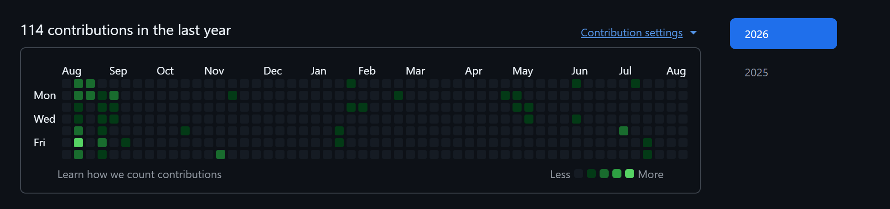
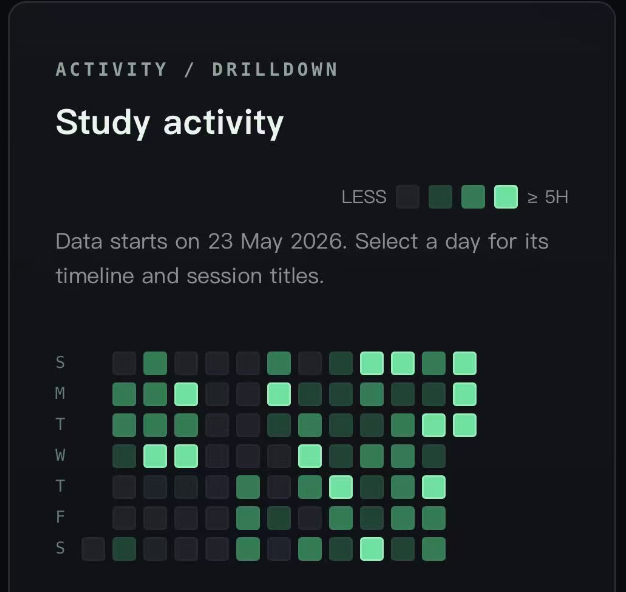

# 知时 · 学习记录

一款轻量、离线优先的个人学习记录应用。专注时隐藏计时结果，完成后再记录学习内容，让注意力留在学习本身。

支持作为网页/PWA 使用，也可以构建为独立 Android APK。所有学习数据默认只保存在当前设备，不需要账号或服务器。

## 功能特性

- **专注计时**：支持暂停、继续以及可选分类
- **分类管理**：在设置中新增、编辑或删除带颜色的学习分类
- **有效时长限制**：少于 25 分钟的学习不会写入历史记录
- **学习归档**：记录标题、笔记、日期、开始时间和学习时长
- **数据分析**：今日进度、最近 7 天趋势、分类分布和 13 周活跃度热力图
- **记录管理**：关键词搜索、详情查看、记录编辑和单条删除
- **中英双语**：在“我的”页面一键切换完整界面语言
- **多种主题**：默认绿、哔站粉、YouTube 红、哔站蓝、暖橙和苹果白
- **备份迁移**：JSON 导出、格式校验、覆盖导入或合并导入
- **自动去重**：合并备份时自动排除重复学习记录
- **离线使用**：PWA Service Worker 与 Android 本地资源均支持离线运行

## 界面参考

项目中的学习活跃度图结合 GitHub Contribution Graph 与移动端学习热力图设计：

| GitHub 风格 | 移动端布局 |
| --- | --- |
|  |  |

## 网页运行

本项目的网页部分不需要构建工具，克隆后即可启动静态服务器：

```powershell
git clone https://github.com/LuminovaBeta/zhishi-app.git
cd zhishi-app
python -m http.server 4173
```

然后访问：

```text
http://127.0.0.1:4173
```

> 通过局域网 HTTP 地址可以在手机上预览，但安装 PWA 需要 HTTPS。正式部署可以使用 GitHub Pages、Cloudflare Pages 或其他静态托管服务。

## Android APK 构建

### 环境要求

- Node.js 20 或更高版本
- npm
- Java 21
- Android SDK Platform 36
- Android SDK Build-Tools 36.0.0

项目已包含 Gradle Wrapper，无需单独安装 Gradle。

### 1. 安装依赖

```powershell
git clone https://github.com/LuminovaBeta/zhishi-app.git
cd zhishi-app
npm ci
```

### 2. 配置 Android SDK

在 `android/local.properties` 中写入本机 Android SDK 路径，例如：

```properties
sdk.dir=C\:\\Users\\your-name\\AppData\\Local\\Android\\Sdk
```

也可以设置环境变量：

```powershell
$env:JAVA_HOME = "C:\Program Files\Eclipse Adoptium\jdk-21"
$env:ANDROID_HOME = "$env:LOCALAPPDATA\Android\Sdk"
```

### 3. 构建调试 APK

```powershell
npm run android:build
```

输出文件：

```text
android/app/build/outputs/apk/debug/app-debug.apk
```

调试 APK 适合个人安装测试。发布到应用商店前，需要创建并妥善保管正式签名，然后构建 release APK 或 AAB。

## 开发流程

网页源码位于仓库根目录。修改完成后，通过以下命令把资源同步到 Android 工程：

```powershell
npm run android:sync
```

同步脚本会将网页资源复制到 `www/`，再执行 Capacitor Android 同步。`www/` 是生成目录，不提交到 Git。

常用命令：

| 命令 | 用途 |
| --- | --- |
| `python -m http.server 4173` | 本地预览网页版本 |
| `npm ci` | 按锁文件安装 Node.js 依赖 |
| `npm run android:sync` | 同步网页资源到 Android 工程 |
| `npm run android:build` | 同步资源并构建调试 APK |

## 数据与备份

学习记录保存在浏览器或 Android WebView 的本地存储中，不会自动上传到云端。

更换设备前：

1. 打开“我的 → 导出数据”。
2. 保存生成的 JSON 备份。
3. 在新设备安装应用。
4. 打开“我的 → 导入备份”。
5. 选择合并现有记录或覆盖现有数据。

导入前会检查 JSON 结构、每日目标、语言、主题以及每条学习记录的科目、标题、时长、日期和开始时间。格式不正确时不会修改现有数据。

## 项目结构

```text
.
├── app.js                    # 页面、状态与业务逻辑
├── styles.css                # 主界面样式
├── heatmap.css               # 活跃度热力图样式
├── theme.css                 # 多主题配色
├── index.html                # 网页入口
├── manifest.webmanifest      # PWA 配置
├── sw.js                     # 离线缓存
├── scripts/sync-web.ps1      # Android 资源同步脚本
├── android/                  # Capacitor Android 工程
└── capacitor.config.json     # Capacitor 配置
```

## 常见问题

### 为什么少于 25 分钟的学习没有保存？

这是应用的有效学习时长规则。结束时不足 25 分钟的会话会被直接丢弃。

### 覆盖安装新版 APK 会丢失记录吗？

使用相同应用包名和签名覆盖更新时，本地数据通常会保留。为避免意外，更新前仍建议导出备份。

### 为什么仓库中没有 APK？

APK 属于构建产物，未纳入 Git 版本控制。可以按照 Android 构建步骤自行生成；正式发行版适合通过 GitHub Releases 发布。

### 这个项目需要 uv 吗？

不需要。项目依赖由 npm、Gradle、Java 和 Android SDK 管理，目前没有 Python 项目依赖。`package-lock.json` 与 Gradle Wrapper 已用于锁定相应依赖版本。

## 隐私说明

- 不要求注册账号
- 不收集或上传学习记录
- 不包含广告与第三方分析代码
- 数据完全由用户自行备份和管理

## License

当前仓库尚未声明开源许可证。在添加许可证之前，默认保留所有权利。
